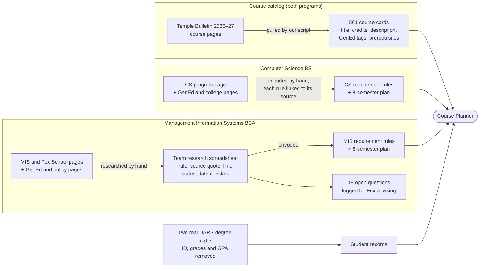
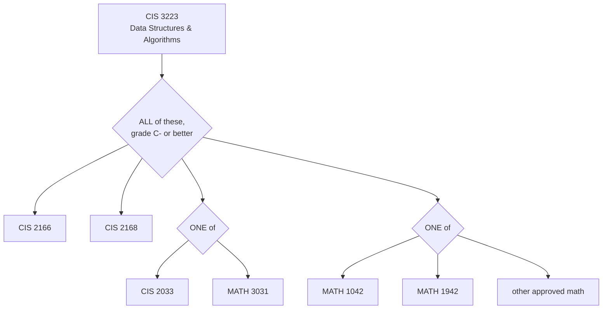
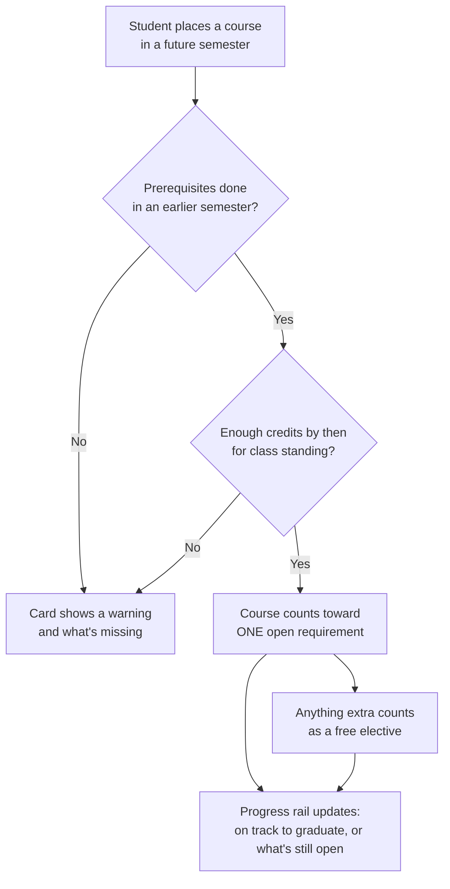

# Course Planner for Temple University

**One place to see what you still need, pick your classes, build your week, and map the path to graduation.**

**Live demo:** [teamx-ecru.vercel.app](https://teamx-ecru.vercel.app)

---

## The problem

To plan a semester at Temple, a student keeps three things open at once:

- **Banner**, to register
- **The degree audit (DARS) or the advising spreadsheet**, to see what's left
- **The Bulletin**, to read course descriptions and prerequisites

Students already have all the information they need, but nothing connects it. Nothing tells them which classes count toward what, whether they can take a class yet, or how a choice this semester changes when they graduate.

## Our goals

1. **Connect what's scattered.** Requirements, courses, prerequisites and the student's own record live on one screen.
2. **Make the next choice obvious.** Show what's still open and which courses fill it, so students don't have to hunt through the Bulletin.
3. **Feel familiar.** We kept Banner's order of steps (pick a term, find classes, check the week, register) and redesigned how each step looks and works.
4. **Use real requirements.** Every rule comes from Temple's official 2026–2027 Bulletin, and both demo students run on their real degree audits.

## What you can do

| | |
|---|---|
| **Get started** | A short onboarding reads your record and shows your year, your program, and what's left to finish. |
| **Find courses** | Search the catalog and see whether each course counts toward a requirement and whether you meet its prerequisites. Keep a shortlist as you go. |
| **Plan your week** | See your courses on a weekly calendar, add or drop courses from your shortlist, then confirm the plan. |
| **Review & register** | Check the plan one last time before registering in Banner. |
| **Four-year plan** | Drag courses into future semesters, or let the planner fill them in. Each card warns you when a prerequisite or class standing isn't met yet. A progress rail tracks every requirement and shows when you're on track to graduate. |
| **Two real students** | Switch between a Computer Science student and a Management Information Systems student to see the same tools work for two different degrees. |

## Built with

| Part | Technology |
|---|---|
| Web app | **Next.js 16**, **React 19** and **TypeScript** |
| Styling | **Tailwind CSS 4** |
| Hosting | **Vercel** |
| Data pipeline | **Python** script that reads the Temple Bulletin and writes the app's data files |
| Design | **Figma** |
| Build process | AI-assisted development with **Claude Code** |

---

## The data

### Where it comes from



- **Course catalog.** A script reads Temple's official Bulletin and collects 561 courses. It turns each prerequisite sentence into rules the app can check (201 courses have them).
- **Computer Science.** We wrote the degree rules from the CS program page and the university pages it depends on. Each rule keeps a link to where it came from.
- **Management Information Systems.** The Fox School spreads its rules across several pages, so we researched it by hand. Each rule went into a shared spreadsheet with the exact source text, a link, a research status and the date we checked it. Where the Bulletin contradicts itself (for example, it gives two different limits for dual majors), we didn't guess. We logged the question with both quotes for Fox advising to settle.
- **Students.** Both demo students run on their real degree audits. We kept only course codes, titles, credits and terms. Student IDs, grades and GPAs stay out because this repository is public.
- **Class times.** Section days, times and instructors are sample data until Temple's live schedule is connected.

### How the data connects

A degree is stored as a **tree of conditions**. Each branch says how its parts combine:

| Condition | Plain English | Real example |
|---|---|---|
| **All of** | Every item below is required | The CS major's core courses |
| **One of** | Pick one course from a list | Capstone: CIS 4397 *or* CIS 4398 |
| **Tagged** | Any course carrying a GenEd tag | Race & Diversity: any course tagged GD |
| **Course range** | Any course in a subject and number range | Business electives: ACCT 2000–3999, and more |
| **Credits from** | Earn enough credits from a list | CS electives: 15–16 credits from the approved list |
| **Waived by** | Skipped when another course is taken | Quantitative Literacy is waived by Calculus |
| **One sequence** | Two courses from the same department | Lab science: Biology A + B, or Chemistry A + B |
| **Credit total** | A minimum number of credits | 123 credits to graduate |

Prerequisites are trees too. Here is the one for **Data Structures and Algorithms (CIS 3223)**, read straight from the Bulletin:



When a student places a course in a future semester, the planner checks it against these rules:



The student's audit is the starting point. Whatever the audit marks as finished stays finished, and the planner only fills what's still open. Each course counts toward only one requirement, so no course is counted twice.

---

## Run it on your computer

You need [Node.js](https://nodejs.org) 20.9 or later.

```bash
cd web
npm install
npm run dev
```

Then open [http://localhost:3000](http://localhost:3000). No accounts, keys or settings are needed.

## What's in this repository

| Folder | What it holds |
|---|---|
| `web/` | The app: pages, components, and the data files in `web/src/data` |
| `web/scripts/` | The script that rebuilds the course data from the Bulletin |
| `api/` | Starting point for a future backend (the demo doesn't use it yet) |
| `productthink.md` | Product decisions from our working sessions |

## What's next

- Connect Temple's live class schedule in place of the sample times
- Store students and plans in a database so anyone can sign in with their own record
- Add an assistant that answers questions and drafts a semester from a plain-language request
- Add more majors using the same research spreadsheet and rule format

---

Built for the Temple AI build competition, 2026. Released under the [MIT License](LICENSE).
